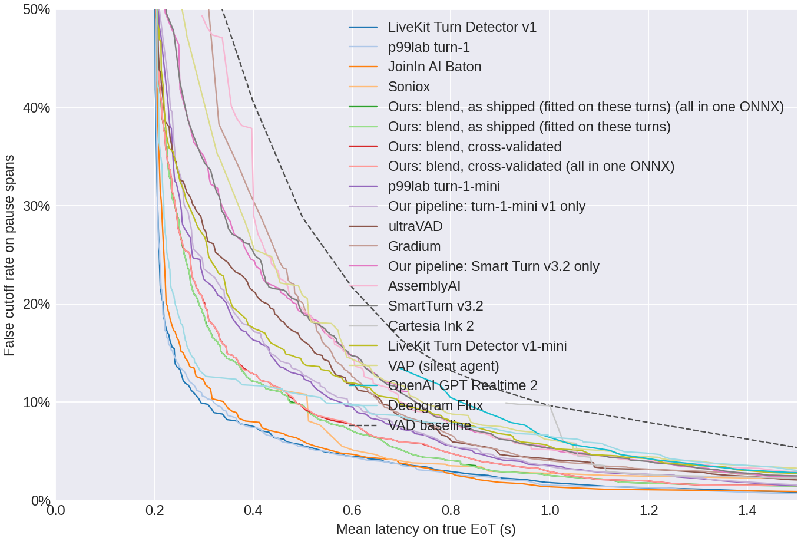
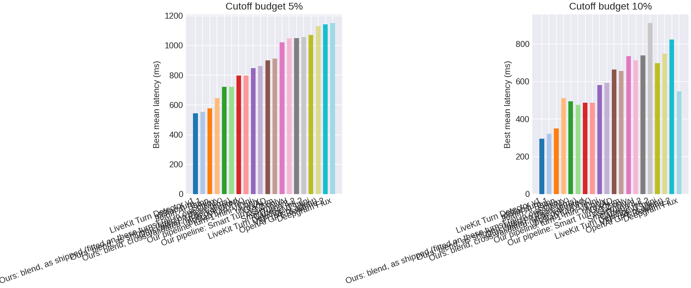
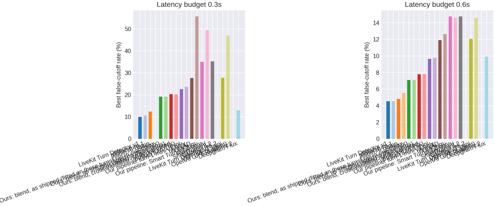

# turn-blend benchmark results

Everything here was measured on `turn-blend.onnx` as shipped in this repository, on a 12-thread laptop CPU
with onnxruntime 1.31. The dataset is [LiveKit eot-bench](https://github.com/livekit/eot-bench), English:
400 real user turns, 1,250 pauses, 11,191 decision points
([data](https://huggingface.co/datasets/livekit/eot-bench-data), revision `ca9d98a`, harness commit `0b5098f`).

Three kinds of latency are reported, and they are different things:

| Latency | What it measures | Headline |
|---|---|---|
| **Decision latency (eot-bench)** | How long after the speaker really stops the turn is declared over, at a fixed false cut-off rate. The benchmark picks the best threshold for each model | 798 ms at 5% cut-offs, 487 ms at 10% |
| **Decision latency (built-in rule)** | The same delay using the model's own default commit rule, no tuning | median 512 ms, mean 630 ms |
| **Compute latency** | CPU time the model takes per 32 ms chunk | 2.3 ms, or 25.6 ms on chunks where Smart Turn runs |

## 1. eot-bench, official harness

Lower is better in every column. "False cut-offs" is the share of mid-turn pauses where the model would have
interrupted the speaker.

| Model | False cut-offs @ 300 ms latency | @ 600 ms | Latency @ 5% cut-offs | @ 10% cut-offs |
|---|---:|---:|---:|---:|
| LiveKit Turn Detector v1 (hosted) | 9.9% | 4.5% | 543 ms | 295 ms |
| p99lab turn-1 | 10.6% | 4.5% | 553 ms | 321 ms |
| JoinIn AI Baton (hosted) | 12.3% | 4.8% | 577 ms | 350 ms |
| Soniox (hosted) | - | 5.5% | 647 ms | 512 ms |
| Deepgram Flux (hosted) | 12.9% | 9.9% | 1151 ms | 548 ms |
| **turn-blend, cross-validated** | **20.1%** | **7.8%** | **798 ms** | **487 ms** |
| turn-blend, weights as shipped (in-sample) | 19.1% | 7.1% | 722 ms | 495 ms |
| p99lab turn-1-mini | 22.6% | 9.6% | 849 ms | 580 ms |
| ultraVAD | 27.7% | 11.9% | 899 ms | 663 ms |
| LiveKit Turn Detector v1-mini | 27.8% | 12.1% | 1070 ms | 698 ms |
| Gradium (hosted) | 55.6% | 12.6% | 913 ms | 656 ms |
| Smart Turn v3.2 | 35.2% | 14.8% | 1051 ms | 739 ms |
| AssemblyAI (hosted) | 49.4% | 14.6% | 1049 ms | 713 ms |
| VAP (silent agent) | 47.0% | 14.6% | 1131 ms | 749 ms |
| Cartesia Ink 2 (hosted) | - | - | 1056 ms | 911 ms |
| OpenAI GPT Realtime 2 (hosted) | - | - | 1143 ms | 824 ms |
| VAD baseline (silence timer only) | 55.6% | 21.7% | 1600 ms | 1000 ms |

Every row except the two turn-blend rows is the result published in the eot-bench repository; they were not
re-run here. A dash means the model has no operating point inside that budget.







The charts and [`results/eot-bench/report.md`](results/eot-bench/report.md) come straight from the harness.
In them turn-blend appears as "Ours: blend ... (all in one ONNX)"; the rows without that suffix are the
earlier multi-file pipeline, and "Our pipeline: ... only" are its two component models run alone as a check.

### How to read the turn-blend rows

- **Cross-validated is the fair row.** The four blend weights were fitted on this benchmark's own 400 turns.
  For the cross-validated row they are refitted on 320 turns and scored on the other 80, five times. The
  "as shipped" row uses the weights in the file and is therefore scored on its own training data.
- **The dataset is small.** A bootstrap over the turns puts the 90% interval of the cross-validated result
  at roughly 16 to 23% (300 ms) and 630 to 940 ms (5% budget). Differences of a point or two between
  neighbouring rows are not meaningful.
- **The harness sweeps its own decision rule** (threshold, minimum silence, timeout) over the model's `blend`
  output. It does not use the model's built-in commit rule; section 2 does.
- Scores where no turn is open, or where the VAD still hears speech, are reported as 0, because the model
  cannot end a turn there.

## 2. The built-in decision rule

The model's own rule with default settings (blend above 0.85 after 320 ms of silence, on two scores in a
row; 3 s timeout), run over the same 400 turns as a stream. Delay is measured from the end of the last word
in the dataset's word timings to the chunk on which the model ended the turn.

| Metric | Value |
|---|---:|
| Turns | 400 (a turn opened in all of them) |
| Median delay | 512 ms |
| Mean delay | 630 ms |
| 75th / 90th / 95th percentile | 776 ms / 1168 ms / 1408 ms |
| Ended within 400 / 500 / 600 ms | 34% / 49% / 62% |
| Ended within 800 / 1000 / 1500 ms | 77% / 84% / 97% |
| Turns ended too early at least once (before the last word finished) | 14.5% |
| Turns whose final end needed the 3 s timeout | 0.5% |
| Tentative end: median delay after the last word | 224 ms |
| Tentative end: median head start over the commit | 256 ms (mean 352 ms) |

- "Ended too early" counts a turn if the model ended it at any pause before the speaker's last word. After
  an early end the model opens a new turn when speech resumes, and the delay above is taken from the end
  that follows the last word.
- This is a per-turn rate and is not comparable with the per-pause rates in section 1.
- The tentative end is the earlier, lower-confidence signal an agent can use to start its LLM while holding
  the output. Nearly every turn (98.8%) had one before its commit.

Raw per-turn results: [`results/rule_latency.0.json`](results/rule_latency.0.json),
[`results/rule_latency.1.json`](results/rule_latency.1.json); summary:
[`results/rule_latency_summary.json`](results/rule_latency_summary.json). The `compute_ms_per_chunk` block
in the summary was measured while two copies of the benchmark shared the CPU and is about twice the idle
figures in section 3; use section 3 for compute time.

## 3. Compute latency

One call processes one 32 ms chunk. Smart Turn sits inside an ONNX `If` and runs only while a turn is open,
on a non-speech chunk, on the scoring cadence (every second chunk by default): about 1 chunk in 12.

| CPU threads | Ordinary chunk | Chunk where Smart Turn runs (95th percentile) | 60 s of audio processed in |
|---|---:|---:|---:|
| 6 | 2.3 ms | 25.6 ms (27.6 ms) | 8.4 s |
| 2 | 2.6 ms | 45.1 ms (47.1 ms) | 12.1 s |
| 1 | 3.2 ms | 79.9 ms (82.0 ms) | 18.4 s |

A scored chunk has 64 ms before the next scored chunk, so real-time use needs at least 2 threads. Measured
on 60 s of continuous speech with the machine otherwise idle.

## 4. In a live voice agent

The Pipecat example (`examples/daily_bot.py -t webrtc`) in a real WebRTC call: Deepgram `nova-3` streaming
STT, OpenAI `gpt-5.4-nano` with reasoning off, Deepgram Aura-2 TTS. A headless browser played six benchmark
turns as its microphone.

| | Range over the call |
|---|---:|
| turn-blend's decision, after the speaker stopped (includes compute) | 426 to 803 ms |
| Full turn latency: speaker stops to bot starts speaking | 1606 to 2248 ms |

The difference is transcription, the LLM's first sentence and speech synthesis. This is one short call on
one machine and network, so treat it as an illustration, not a benchmark. The Daily transport and the
LiveKit integration were not run in a live room; see "Integration status" in the main README.

## 5. Is the single file faithful to the pipeline it was built from?

| Check | Result |
|---|---|
| Smart Turn, turn-1-mini and blend outputs on benchmark turns | differ by at most 0.000001 |
| `in_turn`, `tentative`, `end_of_turn` on 16,948 chunks of multi-turn audio (47 turn ends) | identical |
| eot-bench, cross-validated: original pipeline | 20.3% / 7.8% / 798 ms / 488 ms |
| eot-bench, cross-validated: this file | 20.1% / 7.8% / 798 ms / 487 ms |

## Limits of these results

- One dataset, English, clean 16 kHz single-speaker turns. Telephony audio, noise, other languages and
  overlapping speech are untested.
- The blend was designed, fitted and tuned on this dataset. Expect a smaller gain over its component models
  on other audio.
- Nothing here was submitted to the public eot-bench leaderboard.

## Files

| Path | What it is |
|---|---|
| `results/eot-bench/report.md`, `*.png` | The harness's comparison report and charts, all models |
| `results/eot-bench/ours_*_all_in_one_ONNX/` | turn-blend's two harness runs: predictions, manifest, metrics |
| `results/rule_latency*.json` | Section 2, per turn and summarised |
| `rule_latency.py` | Reproduces section 2 |
| `../lab/bench/` | Research reports, the eot-bench adapter, the cross-validation weights and the parity scripts |

To reproduce section 2: download the English split of `livekit/eot-bench-data`, then

```bash
pip install numpy onnxruntime pyarrow soundfile
python benchmark/rule_latency.py path/to/en/validation-00000-of-00001.parquet
python benchmark/rule_latency.py --summary
```

Section 1 needs the eot-bench harness; the steps are in `../lab/bench/REPORT.md` and
`../lab/bench/all_in_one/bench_aio.py`.
